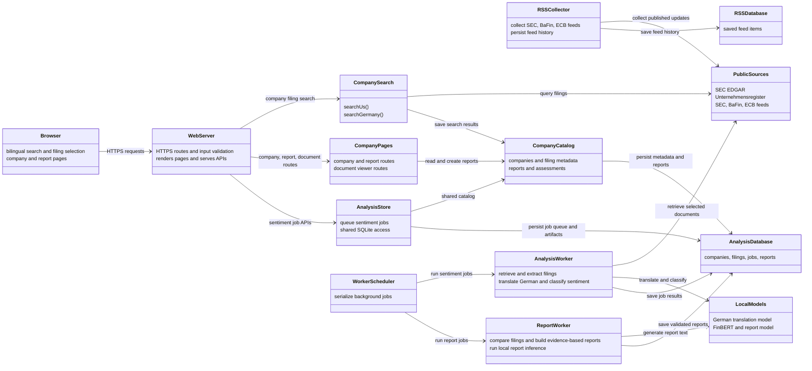

# Capstone Portfolio — Financial Review Web App

**Course:** ESOF 423 — Group 1  
**Semester:** Fall 2026  
**Institution:** Montana State University  
**Team members (alphabetical):** Charles Smith, Owen Sanford

> Draft for team review. Before submitting, complete the marked team details and attach or link the original UML diagrams if available. The repository source is the program listing; this portfolio includes short code examples rather than copying the full project.

## 1. Program

Project 1 (to be later named) is a web application for finding public company filings and making them easier to review. Users can search U.S. SEC filings or German Unternehmensregister publications, select documents, and run local passage-level financial sentiment analysis. The homepage also presents recent updates from SEC, BaFin, and ECB feeds.

### Program specifications

- Search U.S. companies by name, ticker, or CIK; search German company publications by company name. Both markets provide filing or publication type, year, and topic filters.
- Show source-linked filing results. U.S. searches return up to five matching companies and eight matching filings per company. German searches filter up to 30 results from the registry's first results page.
- Queue selected filings for retrieval and passage-level sentiment analysis. English text uses local FinBERT; German text is translated locally before classification. The results are sentiment probabilities, not a financial-bias score.
- Keep feed items and analysis job records in SQLite. Run document retrieval and model inference in a separate local worker.
- See the [architecture and request-flow specification](ARCHITECTURE.md), [operating instructions](OPERATIONS.md), and [source code](https://github.com/423F26/project1/tree/main/src).

Example of the shared analysis-store interface:

```js
return {
  get(id) {
    if (!UUID.test(id)) return undefined;
    return db.prepare(`SELECT id, market, title, filing_url, status, error,
      result_path, created_at, updated_at, completed_at
      FROM analysis_jobs WHERE id=?`).get(id);
  },
  close: () => db.close()
};
```

The implementation is in [`src/analysis-store.js`](https://github.com/423F26/project1/blob/main/src/analysis-store.js#L48). The comments above summarize its behavior; the linked source is authoritative.

## 2. Teamwork

The product backlog assigned work by maintainer and tracked status, completion date, and work points. Team member 1 handled the initial webpage and repository setup, README update, German language toggle, server-side RSS feed, UI update, and bias-detection prototype. Team member 2 handled the initial web interface and demo features, search-interface updates, and RSS filtering. Both members shared the research task defining financial-statement bias. We coordinated through the backlog, and direct communication was straightforward after we exchanged phone numbers.

| Team member | Primary contributions | Estimated share of team project time |
| --- | --- | ---: |
| Team member 1 | Webpage and repository setup; README; German toggle; RSS backend; UI update; bias-detection prototype; shared bias-detection research. | 53.4% |
| Team member 2 | Web interface and demo; search-interface work; RSS filtering; shared bias-detection research. | 46.6% |

The shares use completed work points as a proxy for effort because the backlog does not provide a consistent measure of actual time. Completed solo tasks total 320 points for Team member 1 and 275 for Team member 2. The shared 75-point research task is split equally, giving 357.5 of 670 completed points (53.4%) and 312.5 of 670 (46.6%), respectively. This is an estimate, not a timesheet-based allocation.

## 3. Design pattern

The clearest pattern in the current code is the <mark>Repository pattern</mark>. In [`src/analysis-store.js`](https://github.com/423F26/project1/blob/main/src/analysis-store.js#L48-L105), `openAnalysisStore` owns the SQLite connection and returns named operations such as `enqueue`, `get`, and `getMany`. The server calls those operations instead of embedding the job-storage SQL in each request handler.

We used this separation to keep database work in one place and make the server's request flow easier to read. A direct database query in every route might use fewer layers initially, but would mix HTTP handling with storage details and make shared validation and transaction behavior harder to maintain. The pattern is modest rather than a large framework, which fits the size of this project.

## 4. Technical writing

The project's technical documents are maintained with the code in `docs/`:

- [Architecture](ARCHITECTURE.md) describes components, API behavior, data flow, and security boundaries.
- [Operations](OPERATIONS.md) explains local setup, running the app and worker, and deployment operations.
- [Financial bias analysis specification](BIAS.md) records the intended review criteria and distinguishes planned bias analysis from the sentiment feature that currently runs.

These documents accompany the program and are updated as its behavior changes.

## 5. UML

The diagram below is a UML-style component view of the **current implementation**, based on the source code and [architecture document](ARCHITECTURE.md). It was created after implementation began, so it does not replace the original design diagrams the assignment asks for.



**Team action:** Add or link the UML design diagrams made before coding began, if the team can locate them. If they cannot be found, say so in the submitted portfolio; do not label this retrospective diagram as an original design artifact.

## 6. Design trade-offs

We run document retrieval and model inference in a separate worker rather than inside the web server. This uses more setup and system resources: the project has a second process, its own dependencies, and a larger memory allocation. In return, the web server can handle search and page requests without loading the language models or waiting for inference to finish. It also lets the worker apply document-size and storage limits independently. For a filing-analysis application, keeping model work separate was a reasonable trade-off for clearer resource boundaries, even though it makes local setup more involved. The deployment and request flow are described in [Architecture](ARCHITECTURE.md) and [Operations](OPERATIONS.md).

## 7. Software development life cycle model

Project 1 has been developed iteratively using sprints and a product backlog. The team can point to the maintained [Agile artifacts](agile/README.md) as its planning record. This document encapsulates all of the agile artifacts into one simple spreadsheet. Workload was divided into increments called "sprints." Working in sprints let us build and review the search interface, filing retrieval, and analysis pipeline as separate pieces rather than waiting until the end to see whether the application worked as a whole.

Using the agile process allowed us to build in an efficient manner and improve the project as we came up with better and more thought out ideas. One example was in the RSS implementation when we originally planned to have it user-facing. Since the app is being build for people in the finance niche, it didn't make sense to have the user configure their own RSS feed. Communication between team members has gone smoothly due to a mutual exchange in phone numbers. 
